<p align="center">
  <picture>
    <source media="(prefers-reduced-motion: reduce)" srcset="assets/readme/cover.png">
    
  </picture>
</p>

<h1 align="center">Obsidian Plugin Creator</h1>

<p align="center"><strong>A second brain for your next Obsidian plugin.</strong><br>Give the idea a clear plan, a suitable starting point, and knowledge you can build on.</p>

<p align="center"><a href="#quick-start">Start here</a> · <a href="#what-you-can-make">Explore the starters</a> · <a href="docs/CREATOR_GUIDE.md">Creator guide</a> · <a href="docs/VERIFICATION.md">Verification</a></p>

**Obsidian Plugin Creator brings research, planning, starting code, and review tools into one connected workspace.** Explore the brain in Obsidian or use it with your coding agent to work through a plugin project.

- **Keep the context.** A linked vault holds source-backed guidance and reusable decisions.
- **Shape the idea.** Nine creator playbooks connect the brief, design, implementation, and checks.
- **Start in the right place.** Eight small source starters cover different plugin surfaces.
- **Review with evidence.** Inspect supported warning signs without running the source code.

The public reference pack contains **121 source entries and 200 original paraphrased claims**, reviewed on **1 November 2026**. Browse the [public source catalog](references/public-sources.json). Entries can share an upstream origin.

## Quick start

Download the [complete v0.2.0 source ZIP](https://github.com/AgriciDaniel/obsidian-plugin-creator-public/releases/download/v0.2.0/obsidian-plugin-brain-source-v0.2.0.zip) or clone this repository. Open **`assets/template-brain/`** as a vault in Obsidian and begin with **Plugin Creator Studio**. No command line setup is required to read the knowledge.

For your own intake, notes, reports, and graph configuration, create a separate working vault with Python 3.11 or newer:

```bash
python3 -m obsidian_plugin_brain new my-plugin-brain --owner "Your name" --out-dir ../my-plugin-vaults
```

Open the generated folder in Obsidian. It includes **category colors and seven saved graph views**. Open **Bookmarks**, expand **Plugin Creator graph views**, and choose the overview, sources, concepts, or another focused view. See the [graph guide](assets/template-brain/wiki/meta/Graph%20Views.md).

The command creates fresh private working state locally; the public repository contains no private captures or user configuration. Reading the checked-in template directly does not activate these graph defaults.

<details>
<summary>Bring a coding agent</summary>

Open this complete source checkout in your coding workspace. Ask the agent to read [AGENTS.md](AGENTS.md) and [SKILL.md](SKILL.md), then try:

```text
Use Obsidian Plugin Creator to plan a plugin that helps me [describe the task].
Start with the brief, choose the smallest suitable surface, and define what
we should check before calling the first version complete.
```

The public edition uses `Home` and `Activity` as its navigation notes. See the [public distribution guide](docs/PUBLIC_DISTRIBUTION.md).

</details>

## What you can make

| Your idea | A starting point |
| --- | --- |
| A quick action | A command |
| A dedicated workspace | A dashboard |
| A view of structured notes | A Bases view |
| Help while you write | An editor extension |
| A widget inside a note | A Markdown widget |
| A chart or custom display | A 2D canvas |
| A justified spatial interaction | A 3D scene |
| Patterns across vault metadata | A vault index |

Each starter is a reference example. The actual features of your plugin still need implementation and testing.

## From idea to first build



1. **Describe the task.** Who is it for, and what should become easier?
2. **Shape the experience.** Choose the surface and define observable acceptance criteria.
3. **Build and check a first slice.** Complete the feature, then retain build and actual-runtime evidence separately.

Start with [Plugin Creator Studio](assets/template-brain/wiki/meta/Plugin%20Creator%20Studio.md) and the [creator guide](docs/CREATOR_GUIDE.md).

<details>
<summary>Preview a source starter</summary>

From the complete source checkout:

```bash
python3 -m obsidian_plugin_brain starters
python3 -m obsidian_plugin_brain create-plugin --brief references/creator/example-brief.json --out created-projects/heading-compass --dry-run
```

The preview creates no files. Generation writes a new source project and a file-hash receipt. It does not install dependencies, execute the plugin, change notes, or install into an active vault.

</details>

## Review an existing plugin

The read-only reviewer inspects supported source patterns and attaches source references to its findings.

```bash
python3 scripts/plugin_review_audit.py --plugin-dir /path/to/plugin --json
```

A clear static result does not establish runtime behavior or publication acceptance. See the [product boundaries](docs/PRODUCT_BOUNDARIES.md) and [verification guide](docs/VERIFICATION.md).

## Good questions

<details><summary>Is this an Obsidian plugin?</summary>

It is a knowledge vault and a set of creator and review tools for building plugins. It does not install a finished plugin into your active vault.

</details>

<details><summary>Do I need API keys?</summary>

The local generator and source reviewer make no external provider calls. Your chosen coding agent has its own access requirements.

</details>

<details><summary>Why are there no raw captures in this repository?</summary>

This edition publishes original summaries and public reference metadata. Private research captures, internal ledgers, configuration state, and operational history are excluded. A new working vault creates its own private intake store locally.

</details>

<details><summary>What has been verified?</summary>

See [Verification](docs/VERIFICATION.md) for observed public-edition checks and their limits. Each real plugin still needs its own product, Obsidian, device, and release checks.

</details>

<details><summary>Maintainer references</summary>

The [product spec](references/product-spec.md) defines the buyer and outputs. Read the [public distribution guide](docs/PUBLIC_DISTRIBUTION.md), [publishing policy](PUBLISHING_NOTICE.md), and [release checklist](RELEASE_CHECKLIST.md) before publication. Maturity scores do not establish commercial demand or actual plugin acceptance.

</details>

---

Built by [Daniel Agrici](https://github.com/AgriciDaniel). [Apache 2.0](LICENSE) · [Contributing](CONTRIBUTING.md) · [Support](SUPPORT.md).

An independent project, not affiliated with or endorsed by Obsidian.
